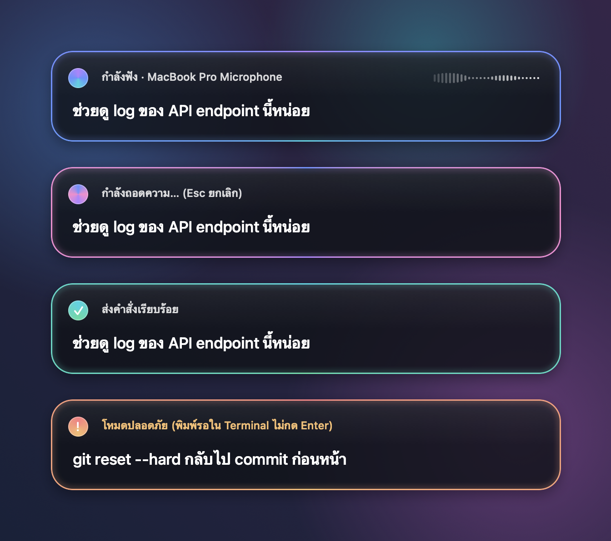

# Voice Agent

Push-to-talk Thai + English dictation for macOS, built for talking to coding agents such as Claude Code.
Press a hotkey, speak a mix of Thai and English the way developers actually do —
*"ช่วย run test แล้ว commit ให้หน่อย"* — and the text lands in the VS Code terminal you were in,
or at the cursor of any other app.


## Why

Apple's dictation hears one language at a time: English terms in Thai speech come out as Thai transliteration
("รีแฟคเตอร์" for *refactor*). Whisper gets the English right but slips on Thai more often. Voice Agent runs both
and merges them word by word, so you get Thai from Apple and the technical terms from Whisper.

## Features

- **One hotkey, two gestures** — `Control-Option-Space`.
  - **Tap**: start listening; it stops after 2.5 s of silence or on the next press. The text is typed, not sent.
  - **Hold**: push-to-talk; releasing the keys types the text and presses Enter.
  - **Esc** cancels while recording or transcribing.
- **Apple Speech + Whisper, merged** — live Thai text from Apple's recognizer while you speak, then
  [whisper.cpp](https://github.com/ggml-org/whisper.cpp) (`large-v3`, quantized) re-transcribes the recording and
  the two are merged. Long dictations are decoded in chunks at your pauses, so the wait at the end stays short.
  Without Whisper installed, Apple's text is used as is.
- **Lands where you were** — a VS Code extension remembers which window, terminal tab or editor cursor had focus
  when you pressed the key, and delivers there even if you have moved on. In any other app (including VS Code
  Insiders, VSCodium and Cursor) the text is typed at the cursor. If nothing confirms delivery, the text is left on the clipboard so nothing you said is lost.
- **Safe by default** — holding to send never presses Enter when the text contains `drop` or `delete` followed by a
  space, or `force`, `rm -rf` or `reset --hard` anywhere (even inside a longer word), or when the two engines disagree
  in a way that needs a second look; the text is typed and waits for you.
- **Only your voice** — once you enroll, whatever only other people's voices fill is silenced before Whisper hears
  it, so a colleague talking in your pauses mostly does not reach Whisper's text. Runs locally, on the microphone
  you enrolled with.
- **Your vocabulary** — example sentences steer Whisper toward your terms, and `term = misheard, spellings` lines fix
  words the engines keep getting wrong. Edits apply to the next recording, no rebuild.
- **Picks the right microphone** — a preference list instead of whatever macOS made the default input last.
- **A HUD that stays out of the way** — a Liquid Glass panel with a soft light that turns while listening and
  decoding, then settles on the outcome.



## Requirements

- macOS 26 or later (the HUD uses Liquid Glass) and the Xcode Command Line Tools (`swiftc`)
- [Homebrew](https://brew.sh) for `whisper-cpp` — optional; about 1 GB of disk for the Whisper model
- Node.js and npm — required: `install.sh` stops if it cannot build the VS Code extension
- VS Code with the `code` command on your `PATH`, to install the extension (otherwise install the `.vsix` by hand)
- Python 3 for the tests, the vocabulary learner and `open-claude-terminal.zsh`
- [Claude Code](https://docs.claude.com/en/docs/claude-code) CLI — optional, only for the vocabulary learner, which
  uses your Claude usage (model `opus` unless `VOICE_AGENT_LEARN_MODEL` says otherwise)

## Install

```bash
git clone https://github.com/<you>/voice-agent.git
cd voice-agent
./install.sh
```

`install.sh` runs the transcript tests, then:

1. builds `~/Applications/VoiceAgent.app` and signs it with a local self-signed certificate, so macOS keeps its
   permissions across rebuilds, and creates the token the VS Code extension checks;
2. installs `whisper-cpp` and downloads the Whisper and VAD models into `~/.local/share/voice-agent/`, then copies
   the starter vocabulary to `~/.config/voice-agent/common.txt` (replaced on every install) and `microphones.txt`
   to the same directory (only when you have none yet);
3. installs `toggle-voice.sh` in `~/.local/bin/`, which starts or stops a recording from a script or shortcut;
4. installs a LaunchAgent that listens for `Control-Option-Space`;
5. builds and installs the VS Code extension;
6. installs the vocabulary learner but pauses its automatic LaunchAgent.

Then:

- **Reload every open VS Code window** (`⌘⇧P` → *Developer: Reload Window*) so it loads the extension.
- **Grant the permissions** macOS asks for on the first recording: Microphone and Speech Recognition.
  To type into apps other than VS Code, also allow VoiceAgent under
  *System Settings → Privacy & Security → Accessibility*. Without it, the text waits on the clipboard for `⌘V`.

## Usage

| Do this | What happens |
|---|---|
| Tap `Control-Option-Space`, speak, stop talking | Text is typed after 2.5 s of silence; Enter is not pressed |
| Tap again while it is listening | Stops now and types the text |
| Hold `Control-Option-Space`, speak, release | Text is typed and Enter is pressed (unless safe mode holds it back; an editor, or a terminal the extension had to open, never gets Enter) |
| `Esc` | Cancels the recording or the transcription |
| Click the `REC` item in the menu bar | Stops listening and types the text |

Wait for the short *tink* before you speak: it plays once the microphone actually delivers sound, which a USB
microphone waking up can take a moment to do. A recording stops on its own after 3 minutes.

### Sending to tmux

The hotkey always records in VS Code mode (VS Code, or the cursor of any other app). To dictate into the tmux session
named `agent` instead, start a recording in tmux mode; it ends on silence, a hotkey tap or `toggle-voice.sh`, and
types the text with `tmux send-keys` without pressing Enter:

```bash
open -n -g ~/Applications/VoiceAgent.app --args tmux
```

### Opening a Claude Code terminal from a script

`scripts/open-claude-terminal.zsh [dir]` asks the extension to open a new VS Code terminal tab in `dir` and start
Claude Code there. `VOICE_AGENT_VSCODE_APP` picks the VS Code app by name or path (default: `Visual Studio Code`).

## Configuration

All settings live in `~/.config/voice-agent/` and are read at every recording.

### Vocabulary

The app combines `~/.config/voice-agent/common.txt`, `user.txt`, and one selected work file. `common.txt` is
replaced by the installer; put personal terms in `user.txt` and work-specific terms in `work/<name>.txt` instead.
None of these personal files belongs in the public repository.

To select a work file, write its name without `.txt` to `~/.config/voice-agent/active-work.txt`. Names may contain
letters, digits, `_`, or `-`. An empty or invalid selection loads no work file. If `active-work.txt` does not exist,
the existing `vocabulary.txt` is loaded as the legacy work file; it is never overwritten by the installer.

All vocabulary files use the same format:

```text
# Example sentences, one per line, spoken the way you really say them; English terms spelled in English.
ช่วย run test แล้ว commit แล้ว push ขึ้น branch main
ดู log ของ API endpoint

# term = what the engines wrote instead, comma-separated: replaced in the final text.
keyword = คีย์ Word, คีย์เวิร์ด
null = เนาว์, เนา, นัลล์
```

Sentences become Whisper's prompt (keep them short: Whisper reads at most 224 tokens of prompt) and their English
terms become hints for Apple's recognizer. A bare word list does not work; terms need to sit inside sentences.
`=` lines are exact replacements for words that are misheard the same way again and again; English spellings match
whole words, case-insensitively.

### `microphones.txt`

```text
# Best first: any part of the device's name, any case. The first one plugged in records.
PD200X
USBC Headset
```

With none of them connected the recorder picks a wired microphone, then the built-in one, then a wireless one, and
never a virtual device. To list the names it sees and the one it would pick:

```bash
~/Applications/VoiceAgent.app/Contents/MacOS/voice-agent microphones
```

### Speaker gate

`install.sh` downloads [sherpa-onnx](https://github.com/k2-fsa/sherpa-onnx)'s C library and the CAM++ zh+en speaker
model into `~/.local/share/voice-agent/speaker/`. Enroll with recordings of you alone and the microphone they were
made with (any part of its name); until then the gate is off and Whisper hears everything:

```bash
~/Applications/VoiceAgent.app/Contents/MacOS/voice-agent enroll --mic PD200X ~/Library/Caches/voice-agent/<recording>.wav …
~/Applications/VoiceAgent.app/Contents/MacOS/voice-agent gate <recording>.wav [gated.wav]   # what it would silence
```

Every 1.5 s window (every 0.5 s) with at least 0.5 s of sound is compared with your voiceprint; a stretch where every
window scores under 0.3 is silenced, keeping a margin next to your words, even when that is all of a run (Whisper
decodes a long dictation in runs of about 6 s). On any other microphone the gate is off, since your voice scores lower
there. Words Whisper misses this way stay in the text from Apple's recognizer (but for a word repeating its neighbour,
taken as a stammer), which is not gated: the live text in the HUD is Apple's. Each run's scores go to the log as a
`gate` line. A bystander Apple's recognizer also heard still reaches the text, so when the gate silenced someone and the
text keeps words only Apple heard, a dictation held to send is typed without Return for you to check. A bystander also
reaches Whisper's text when talking over you, in that margin (0.5 s to about 1 s, more when a window mostly theirs still
scores as yours), for under 0.5 s, or in a run shorter than 1.5 s.

### Learner

Automatic learning is paused. The legacy learner reads a combined dictation log and can send its contents to Claude;
it cannot distinguish work contexts. Do not run it on confidential recordings without the required authorization.
It writes only to the legacy `vocabulary.txt` (reading `feedback.txt` lines of the form `what came out -> what I said`),
so once `active-work.txt` exists nothing it learns is loaded.

```bash
python3 ~/.local/share/voice-agent/learn/learn.py --status   # what it has seen and done
python3 ~/.local/share/voice-agent/learn/learn.py --revert   # undo the last legacy vocabulary change
```

## How it works

```
Control-Option-Space ─► hotkey listener (LaunchAgent)
                           │ launches / signals
                           ▼
                        recorder ── audio ──► Apple Speech (live text in the HUD)
                           │                └► 16 kHz WAV ─► whisper.cpp (per pause / chunk)
                           ▼
                        merge Apple + Whisper ─► vocabulary corrections ─► safety checks
                           │
                           ├─► VS Code extension (vscode:// link + token) ─► terminal tab or editor
                           ├─► any other app: typed at the cursor (Accessibility)
                           └─► tmux send-keys
```

- The hotkey listener and the recorder are the same binary (`swift-cli/VoiceAgentCLI.swift`); the recorder runs as
  its own app instance so it owns the Microphone and Speech permissions.
- The VS Code extension only accepts links carrying a token from `~/.local/share/voice-agent/uri-token`, which only
  your user can read, so a link on a web page cannot type into your terminal. It confirms each delivery with an ack
  file; without one the recorder keeps the text on the clipboard.

| Path | What is there |
|---|---|
| `~/Library/Logs/voice-agent.log` | Each recording: what each engine heard and where the text went |
| `~/Library/Caches/voice-agent/` | The latest 200 recordings, for re-measuring changes on real speech |
| `~/.local/share/voice-agent/` | Whisper models, the URI token, signing keychain, learner state |
| `~/.local/share/voice-agent/speaker/` | The speaker gate's library, model and your voiceprint |
| `~/.config/voice-agent/` | Your vocabulary layers and microphones |

## Development

```bash
tests/run.sh            # transcript merge, corrections, chunking, microphone choice, vocabulary layers
tests/run.sh --update   # accept new merge output into tests/merge_golden.tsv (review the printed diff first)
```

The tests build a harness from the app source and run example transcripts through the merge, so a change that
alters dictation output fails here before `install.sh` builds anything.

| Directory | Contents |
|---|---|
| `swift-cli/` | The macOS app: hotkey listener, recorder, HUD, merge |
| `vscode-extension/` | Delivers text to the focused terminal or editor and opens Claude Code terminals |
| `scripts/` | Signing, the toggle script, the learner, starter config files |
| `tests/` | Golden transcript tables and the harness that runs them |

## Uninstall

```bash
launchctl bootout gui/$(id -u) ~/Library/LaunchAgents/com.local.voiceagent.hotkey.plist
launchctl bootout gui/$(id -u) ~/Library/LaunchAgents/com.local.voiceagent.learn.plist 2>/dev/null   # older installs
rm -f ~/Library/LaunchAgents/com.local.voiceagent.{hotkey,learn}.plist
launchctl enable gui/$(id -u)/com.local.voiceagent.learn   # undoes the "disabled" override install.sh sets
rm -rf ~/Applications/VoiceAgent.app ~/.local/bin/toggle-voice.sh
code --uninstall-extension local.voice-agent-terminal
security delete-keychain ~/.local/share/voice-agent/signing.keychain-db   # the app's signing certificate
# Optional: your settings, models, recordings and logs
rm -rf ~/.config/voice-agent ~/.local/share/voice-agent ~/Library/Caches/voice-agent ~/Library/Logs/voice-agent*.log
```

## License

[MIT](LICENSE)
